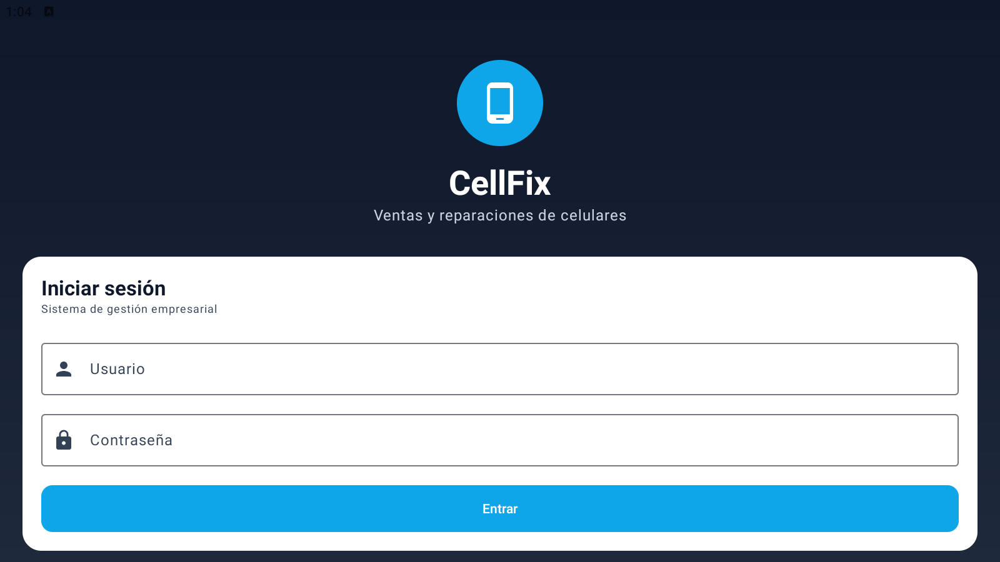
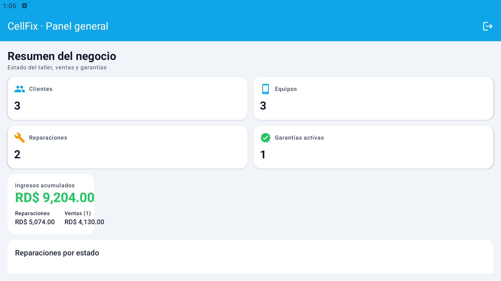
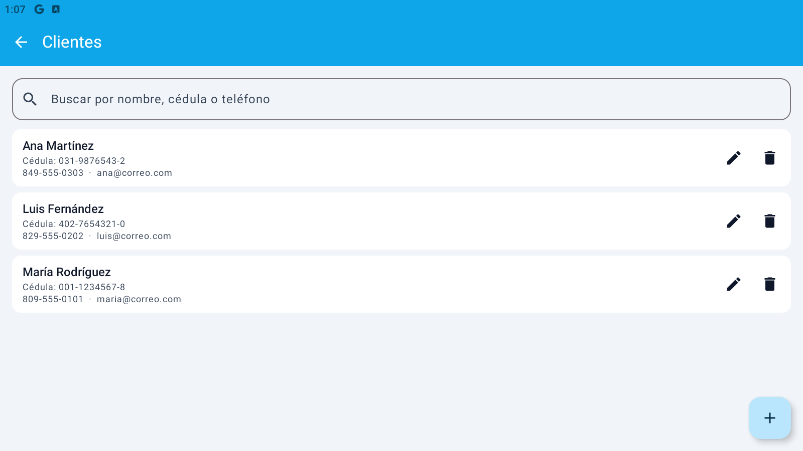
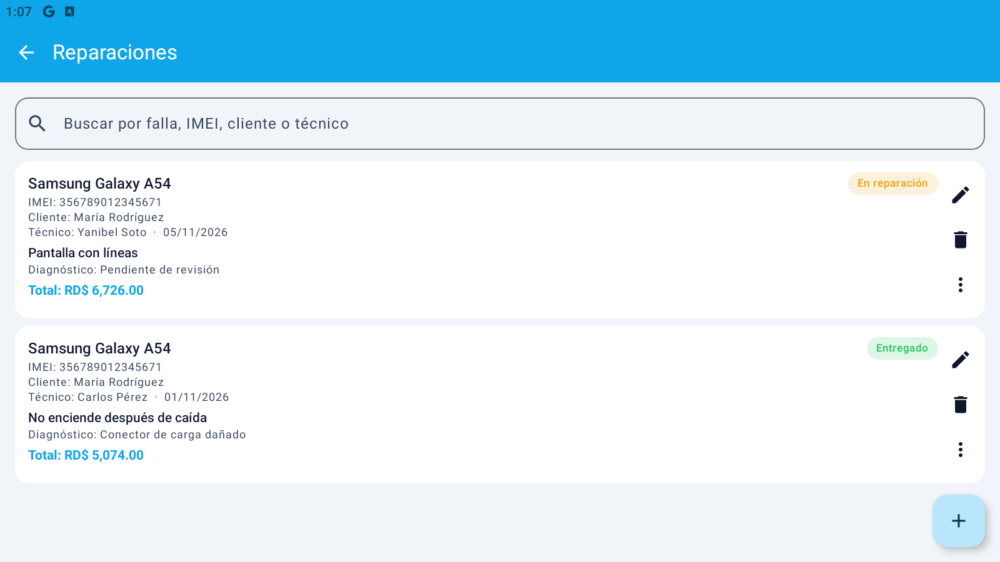
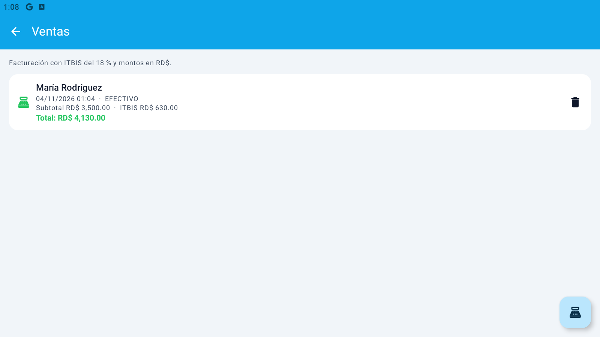
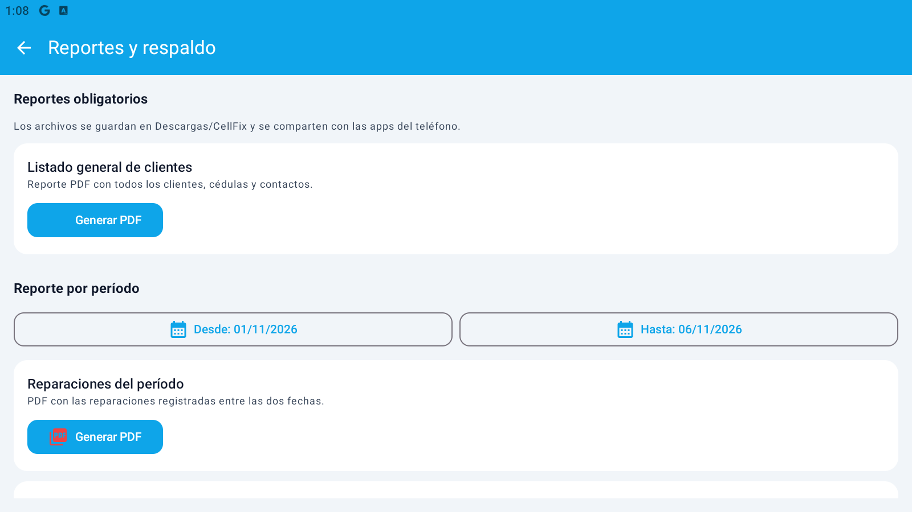

# CellFix · Ventas y reparaciones de celulares

Aplicación Android nativa para la gestión de un taller de telefonía: clientes, equipos
identificados por IMEI, reparaciones, garantías, ventas con ITBIS y reportes PDF/CSV.

**Centro Educativo San Valero** · **6to I** · **Alumno:** Derek Yasunary Jiménez Oviedo · **No. 16**

---

## 1. Descripción

CellFix resuelve el control diario de un negocio dominicano de venta y reparación de
teléfonos. El sistema permite registrar clientes, asociarles equipos por IMEI, abrir
órdenes de reparación, asignar técnicos, calcular costos con ITBIS del 18 %, entregar
equipos generando una garantía de 30 días y facturar accesorios o equipos.

La **regla de negocio principal** es el control de garantías por IMEI: al marcar una
reparación como `ENTREGADO`, la aplicación crea automáticamente una garantía de 30 días
y evita duplicarla mientras siga vigente.

## 2. Tecnologías obligatorias

| Requisito | Implementación |
|---|---|
| Kotlin + Android nativo | Kotlin 2.0.21, SDK 35 |
| Jetpack Compose + Material 3 | Compose BOM 2024.10.01, tema propio claro/oscuro |
| Room / SQLite | Room 2.6.1 con 8 entidades y claves foráneas |
| MVVM + Clean Architecture | 3 capas: `data`, `domain`, `ui` |
| Hilt | Hilt 2.52 + KSP |
| Corrutinas y Flow | `StateFlow`, `Flow`, `viewModelScope` |
| Navigation Compose | `NavHost` con 8 rutas |
| Reportes PDF/CSV | `PdfDocument` + CSV con BOM UTF-8 |
| Gradle Kotlin DSL | `build.gradle.kts`, version catalog |
| Login con 2 roles | ADMIN y OPERADOR, contraseñas PBKDF2 con sal |
| Reglas dominicanas | ITBIS 18 %, RD$, cédula/RNC, formato dd/MM/yyyy |
| Respaldo de BD | Exportar/importar archivo SQLite |

## 3. Funcionalidades

1. **Autenticación local** con dos roles y contraseñas hasheadas (PBKDF2-HMAC-SHA256, 60 000 iteraciones).
2. **Clientes**: CRUD completo, validación de cédula (11 dígitos), teléfono y correo, búsqueda por texto.
3. **Equipos**: CRUD, IMEI único de 15 dígitos, relación con cliente, búsqueda por marca/modelo/IMEI/cliente.
4. **Técnicos**: CRUD, especialidad, estado activo/inactivo.
5. **Reparaciones**: CRUD, equipo y técnico asociados, falla, diagnóstico, costos, ITBIS y total; cambio de estado con flujo `RECIBIDO → DIAGNOSTICO → EN_REPARACION → LISTO → ENTREGADO`, más `CANCELADO`.
6. **Garantías**: creación automática de 30 días al entregar, consulta por IMEI, estado vigente/vencida, eliminación.
7. **Ventas**: registro de varios artículos, subtotal, ITBIS 18 %, total, método de pago, eliminación.
8. **Dashboard**: indicadores de clientes, equipos, reparaciones, garantías activas, ventas e ingresos; gráfico de barras por estado.
9. **Reportes**: listado general de clientes (PDF), reporte por período (PDF y CSV) y resumen gerencial (PDF).
10. **Respaldo**: exportación e importación del archivo `cellfix.db`.
11. **Tema Material 3** con modo claro/oscuro automático, icono propio y tipografía Material.
12. **Datos de demostración** precargados en el primer arranque.

## 4. Usuarios de demostración

| Usuario | Contraseña | Rol | Acceso |
|---|---|---|---|
| `admin` | `admin123` | Administrador | Todos los módulos, incluidos técnicos y reportes |
| `operador` | `operador123` | Operador | Clientes, equipos, reparaciones, garantías y ventas |

> Las contraseñas nunca se almacenan en texto plano. La semilla se ejecuta una sola vez
> y crea los usuarios con sal aleatoria y hash PBKDF2.

## 5. Arquitectura

```
app/src/main/java/com/sanvalero/cellfix/
├── data/                  Capa de datos
│   ├── local/             Room: AppDatabase, entidades y DAOs
│   ├── mapper/            Conversión entidad ↔ modelo de dominio
│   ├── repository/        Implementación de CellFixRepository
│   └── session/           Sesión en memoria
├── domain/                Capa de dominio (sin Android)
│   ├── model/             Modelos y constantes de negocio
│   ├── repository/        Contrato CellFixRepository
│   └── usecase/           Login, validaciones, ITBIS y garantías
├── di/                    Módulos de Hilt
├── report/                Generación de PDF y CSV
├── ui/                    Capa de presentación
│   ├── components/        Componentes reutilizables de Compose
│   ├── navigation/        CellFixRoot y NavHost
│   ├── screens/           Login, dashboard, clientes, equipos, técnicos,
│   │                      reparaciones, garantías, ventas, reportes
│   ├── session/           SessionViewModel
│   └── theme/             Colores, tipografía y tema Material 3
├── util/                  Formatos, criptografía y respaldo
├── CellFixApp.kt          Application con Hilt
└── MainActivity.kt        Activity única con Compose
```

**Regla de dependencia:** `ui → domain ← data`. La interfaz nunca accede a DAOs; siempre
usa `CellFixRepository`. Los ViewModels exponen `StateFlow` y las pantallas son funciones
`@Composable` sin lógica de negocio.

### Flujo de una reparación

1. El operador registra el cliente y su equipo (IMEI de 15 dígitos).
2. Crea la reparación y selecciona técnico.
3. Calcula mano de obra + repuestos y aplica ITBIS 18 %.
4. Cambia el estado hasta `ENTREGADO`.
5. El sistema guarda la fecha de entrega y crea la garantía de 30 días.
6. La garantía se consulta por IMEI desde el módulo Garantías.

## 6. Modelo de datos

8 entidades Room con claves foráneas y borrado en cascada:

- `usuarios` (username único)
- `clientes` (cédula única)
- `equipos` (IMEI único, FK a cliente)
- `tecnicos`
- `reparaciones` (FK a equipo y técnico)
- `garantias` (FK única a reparación)
- `ventas` (FK a cliente)
- `detalle_venta` (FK a venta)

El detalle completo está en [`docs/03-modelo-datos.md`](docs/03-modelo-datos.md).

## 7. Compilar y ejecutar

### Requisitos

- Android Studio Ladybug o superior (recomendado).
- JDK 17.
- Android SDK 35 y Build-Tools 35.
- Dispositivo físico o emulador con Android 8.0 (API 26) o superior.

### Desde Android Studio

1. Abre la carpeta `sanvalero-6toI-16-cellfix`.
2. Espera la sincronización de Gradle.
3. Conecta el teléfono con depuración USB activada.
4. Ejecuta la configuración `app`.

### Desde consola

```bash
./gradlew assembleDebug
./gradlew installDebug
```

En Windows:

```powershell
.\gradlew.bat assembleDebug
.\gradlew.bat installDebug
```

El APK de depuración queda en `app/build/outputs/apk/debug/app-debug.apk`.

### APK de release

```powershell
.\gradlew.bat assembleRelease
```

Para publicar en GitHub se recomienda adjuntar `app-release.apk` en la Release `v1.0.0`.

## 8. Reportes y respaldo

- Los archivos se guardan en la carpeta privada `Android/data/com.sanvalero.cellfix/files/reportes`.
- En Android 10 o superior se copian además a `Descargas/CellFix`.
- Se comparten con el selector del sistema mediante `FileProvider`.
- El respaldo se guarda en `Android/data/com.sanvalero.cellfix/files/backups`.
- Después de importar un respaldo, cierra y vuelve a abrir la aplicación para que Room
  tome el archivo restaurado.

## 9. Documentación

- [Análisis de requisitos](docs/01-analisis-requisitos.md)
- [Arquitectura y decisiones](docs/02-arquitectura.md)
- [Modelo de datos](docs/03-modelo-datos.md)
- [Manual de usuario](docs/04-manual-usuario.md)
- [Pruebas y despliegue](docs/05-pruebas-y-despliegue.md)
- [Guía de GitHub](docs/06-guia-github.md)
- [Bitácora de uso de IA](docs/prompts/bitacora-ia.md)
- [Checklist de entrega](docs/07-checklist-entrega.md)

## 10. Repositorio

- GitHub: <https://github.com/derekyjo/sanvalero-6toI-16-cellfix>
- Rama principal: `main`
- Rama de desarrollo: `develop`
- Versión: `v1.0.0`

## 11. Créditos

Proyecto individual desarrollado por **Derek Yasunary Jiménez Oviedo** para la asignatura
de Desarrollo de Aplicaciones Android, 6to I, Centro Educativo San Valero.

## 12. Capturas de la aplicación

Capturas reales tomadas ejecutando el APK `v1.0.0` en BlueStacks 5 (Android 9, API 28).

| Pantalla | Captura |
|---|---|
| Inicio de sesión |  |
| Panel general |  |
| Clientes |  |
| Reparaciones |  |
| Ventas con ITBIS |  |
| Reportes y respaldo |  |
