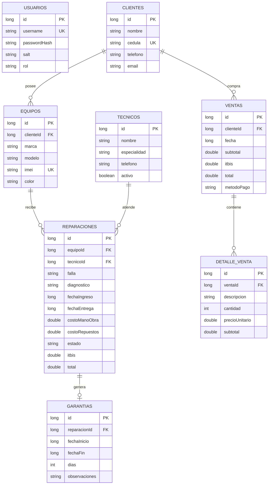

# 03 · Modelo de datos

## 1. Diagrama entidad-relación



## 2. Entidades

### Usuarios

| Campo | Tipo | Restricción |
|---|---|---|
| `id` | Long | PK autogenerada |
| `username` | String | único, obligatorio |
| `passwordHash` | String | PBKDF2, obligatorio |
| `salt` | String | Base64, obligatorio |
| `rol` | String | `ADMIN` u `OPERADOR` |

### Clientes

| Campo | Tipo | Restricción |
|---|---|---|
| `id` | Long | PK |
| `nombre` | String | obligatorio |
| `cedula` | String | único, 11 dígitos |
| `telefono` | String | al menos 10 dígitos |
| `email` | String | opcional, formato válido |

### Equipos

| Campo | Tipo | Restricción |
|---|---|---|
| `id` | Long | PK |
| `clienteId` | Long | FK → `clientes.id`, `CASCADE` |
| `marca` | String | obligatorio |
| `modelo` | String | obligatorio |
| `imei` | String | único, 15 dígitos |
| `color` | String | opcional |

### Técnicos

| Campo | Tipo | Restricción |
|---|---|---|
| `id` | Long | PK |
| `nombre` | String | obligatorio |
| `especialidad` | String | obligatorio |
| `telefono` | String | al menos 10 dígitos |
| `activo` | Boolean | por defecto `true` |

### Reparaciones

| Campo | Tipo | Restricción |
|---|---|---|
| `id` | Long | PK |
| `equipoId` | Long | FK → `equipos.id`, `CASCADE` |
| `tecnicoId` | Long | FK → `tecnicos.id`, `RESTRICT` |
| `falla` | String | obligatorio |
| `diagnostico` | String | opcional |
| `fechaIngreso` | Long | epoch ms |
| `fechaEntrega` | Long? | nulo mientras no se entrega |
| `costoManoObra` | Double | ≥ 0 |
| `costoRepuestos` | Double | ≥ 0 |
| `estado` | String | ver flujo de estados |
| `itbis` | Double | 18 % del subtotal |
| `total` | Double | subtotal + ITBIS |

### Garantías

| Campo | Tipo | Restricción |
|---|---|---|
| `id` | Long | PK |
| `reparacionId` | Long | FK única → `reparaciones.id`, `CASCADE` |
| `fechaInicio` | Long | epoch ms |
| `fechaFin` | Long | inicio + 30 días |
| `dias` | Int | 30 |
| `observaciones` | String | texto libre |

> El índice único en `reparacionId` garantiza una sola garantía por reparación. Además,
> `GarantiaUseCase` comprueba que no exista otra garantía vigente para el mismo equipo
> (IMEI) antes de crear una nueva.

### Ventas y detalle

`ventas` guarda el encabezado (cliente, fecha, subtotal, ITBIS, total, método de pago) y
`detalle_venta` guarda los artículos. La creación se hace dentro de una transacción Room:
si falla el detalle, no queda una venta huérfana.

## 3. Estados de una reparación

```text
RECIBIDO → DIAGNOSTICO → EN_REPARACION → LISTO → ENTREGADO
     └────────────── CANCELADO ──────────────┘
```

Al pasar a `ENTREGADO`:

1. Se guarda `fechaEntrega` con la hora actual.
2. Se invoca `GarantiaUseCase.crearParaReparacion`.
3. Se valida el IMEI del equipo.
4. Se comprueba que no exista garantía vigente para la reparación.
5. Se inserta una garantía de 30 días.

## 4. Reglas de negocio

| Código | Regla |
|---|---|
| RN-01 | El IMEI debe tener exactamente 15 dígitos y ser único. |
| RN-02 | La cédula debe tener 11 dígitos y ser única. |
| RN-03 | El RNC puede tener 9 u 11 dígitos. |
| RN-04 | El teléfono debe tener al menos 10 dígitos. |
| RN-05 | El ITBIS es 18 % y se redondea a 2 decimales. |
| RN-06 | La garantía dura 30 días desde la entrega. |
| RN-07 | No se permite otra garantía vigente para el mismo IMEI. |
| RN-08 | Un técnico con reparaciones no puede eliminarse (`RESTRICT`). |
| RN-09 | Al eliminar un cliente se eliminan en cascada sus equipos, reparaciones, garantías y ventas. |
| RN-10 | Toda venta debe tener al menos un artículo válido. |

## 5. DAOs y consultas

| DAO | Consultas principales |
|---|---|
| `UsuarioDao` | buscar por username, contar |
| `ClienteDao` | observar todos, buscar por texto, contar |
| `EquipoDao` | observar con cliente, buscar, buscar por IMEI, contar |
| `TecnicoDao` | observar todos, observar activos, contar |
| `ReparacionDao` | observar detalle, buscar, contar por estado, sumar entregadas |
| `GarantiaDao` | observar detalle, buscar por IMEI, contar activas |
| `VentaDao` | observar resumen con cliente, contar, sumar totales |
| `DetalleVentaDao` | observar detalle por venta, insertar lote, borrar por venta |

## 6. Respaldo

El archivo generado por Room es `cellfix.db`. Se usa journal `TRUNCATE` para que toda la
información esté en un solo archivo al exportar. La importación sobrescribe el archivo y
elimina restos `-wal`/`-shm`; después se recomienda reiniciar la aplicación.
